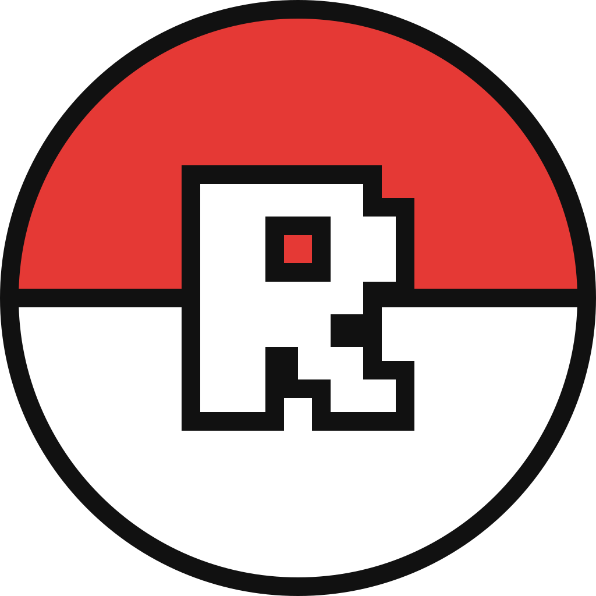
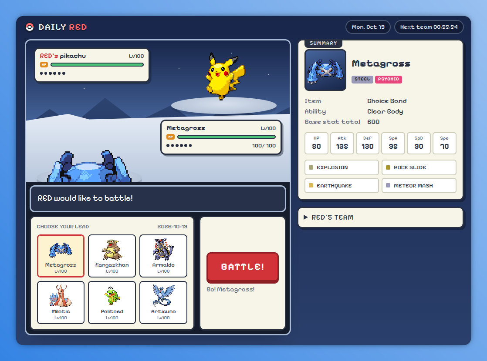

<p align="center">
  
</p>

# DailyRedDiscord

A Discord Activity that simulates a Pokemon battle against Red, in the style of
[daily-red.com](https://daily-red.com), powered by
[pokemon-showdown](https://github.com/smogon/pokemon-showdown).



## Structure

- `client/` - React + Vite frontend, embedded via the Discord SDK
- `server/` - Express backend; authoritative battle engine + OAuth token exchange
- `shared/` - `@dailyred/shared`, the wire-contract types used by both
- `ai/` - Red's brain: a thin Python wrapper around
  [Foul Play](https://github.com/pmariglia/foul-play), which searches battles with
  [poke-engine](https://github.com/pmariglia/poke-engine)

## How Red plays

Everyone on the same date gets the same team and battle seed, and the same
difficulty for Red. The date's seed picks how strong Red is that day, from
0.75 to 1 (full-strength Foul Play); he never plays badly on purpose. Red's
moves themselves are not seeded, since the search is not deterministic, so two
players can see Red play differently.

Red's choices are stored as he makes them, so an interrupted battle is rebuilt
by replaying both sides' stored choices rather than asking the bot again. If
the bot is missing, crashes, is too slow or picks an illegal move, Red plays a
random legal move instead, so a battle never stalls. Battles begun before Foul
Play was added keep the original seeded random AI.

## Setup

1. `cp example.env .env` and fill in your Discord app credentials
2. `npm install` at the repo root (npm workspaces)
3. `ai/setup.sh` to install Red's brain (needs python3.11+, git, curl and a Rust
   toolchain; it takes about 20 seconds). Without it Red plays random moves.
4. `npm run dev:client` and `npm run dev:server` from the repo root

## Leaderboard command

`/leaderboard` shows a server's top 10 players by win rate. It is a slash
command delivered to the server over Discord's interactions endpoint, so no bot
token or gateway connection is needed.

1. Set `DISCORD_PUBLIC_KEY` in `.env` (Developer Portal -> General Information).
2. In the portal, set **Interactions Endpoint URL** to
   `https://<your public host>/api/interactions`.
3. Register the command with `npm run register-commands -w server`.
4. The app must be installed in the server with the `applications.commands` scope.

Players only appear on a server's board once they have opened the activity
from that server. Players with fewer than 3 finished games are listed after
everyone else.

## Deployment

A GitHub Action (`.github/workflows/docker-publish.yml`) builds and pushes the
Docker image whenever a release is published. It needs these repository
secrets: `DOCKER_HUB_USERNAME`, `DOCKER_HUB_PASSWORD` and
`VITE_DISCORD_CLIENT_ID` (public; it is compiled into the client).

The image serves both the built client and the API on port 3001. Run it with:

```
docker run -d -p 3001:3001 -v dailyred-data:/data \
  -e VITE_DISCORD_CLIENT_ID=... -e DISCORD_CLIENT_SECRET=... \
  -e DISCORD_PUBLIC_KEY=... -e DB_BACKUP_DIR=/data/backups \
  diamondcoder295/dailyreddiscord:latest
```

- **Persistence:** everything lives in the SQLite file at `/data/dailyred.sqlite`
  (set via `DB_PATH`), so mount a volume on `/data`. For a bind mount, make it
  writable by the container's `node` user (uid 1000).
- **One instance only.** Live battles are held in memory, so run a single
  replica. Restarts are safe: every accepted move is stored, and a battle is
  replayed on its next use.
- **Behind a reverse proxy**, set `TRUST_PROXY` to the number of proxies so rate
  limiting sees real client IPs. `GET /healthz` is a liveness check.
- **Backups:** set `DB_BACKUP_DIR` for a daily consistent copy (last 7 kept).
- **Red's brain** is built into the image (Python plus a Rust-built poke-engine),
  so the first build is slower. Each active battle runs one small Python process
  (about 40 MB), stopped when the battle ends or goes idle.
- Other options are listed at the bottom of `example.env`.

## License

GPL-3.0, see `LICENSE`. Foul Play, which this project runs, is GPL-3.0 too.

